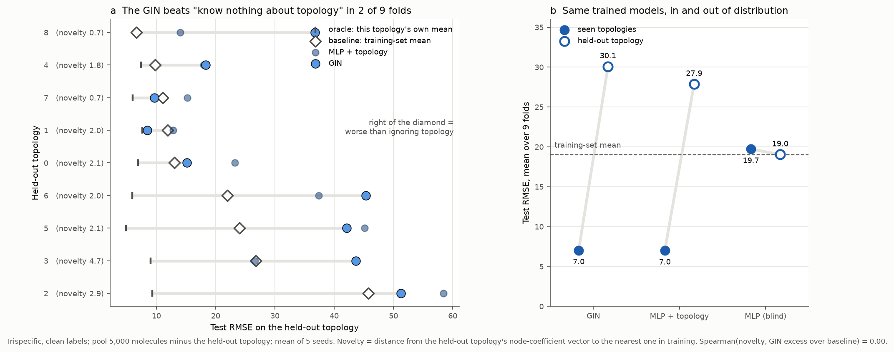

# Disentangling multispecific antibody function with graph neural networks

We present a generative method for creating large-scale, realistic synthetic functional landscapes that capture nonlinear interactions where biological activity depends on domain connectivity. Second, we have several baselines including a graph neural network architecture and a sequence-only MLP using this data generation process. 

---

## This fork: does the GIN actually beat a topology-conditioned MLP?

> **Fork of [prescient-design/synapse](https://github.com/prescient-design/synapse).** Added work lives in [`baseline/`](baseline/); upstream code is unchanged apart from seeding fixes.

**The original workflow** generates synthetic multispecific antibodies as graphs and trains a GIN against a sequence-only MLP, showing the GIN wins by a growing margin as the dataset grows (Figure 2).

**What I changed.** The upstream MLP cannot see connectivity at all, so that comparison measures topology identification — and topology alone is ~88% of the label variance. I added a third baseline, the *format-conditioned* MLP the paper describes in §5.3 (nine learned scalars, one per topology), then stress-tested all three with assay noise that cannot be averaged away — fold error, batch effects confounded with molecular format, and saturating readouts — and with a leave-one-topology-out split.

**Result.** The GIN's advantage is topology identification and nothing more. Nine scalars close the gap on clean data (6.63 vs 6.48 RMSE); the conditioned MLP matches or beats the GIN under every noise model tested; and on a topology held out of training the GIN does *worse than predicting a constant*, in 7 of 9 folds. Separately, when batch effects are confounded with format, a standard random split reports a ~25% improvement that does not exist against the true labels.



**Reproduce:**
```bash
python -m baseline.heldout_topology    # 135 runs, ~20 min on 8 cores
python -m baseline.noise_study         # 810 runs, ~overnight on 8 cores
python -m baseline.plot_heldout        # regenerate the figure above
```

📄 **[Full method and conclusions → FINDINGS.md](FINDINGS.md)**  ·  differences from the paper: [baseline/PAPER_VS_REPO.md](baseline/PAPER_VS_REPO.md)

---

### Running Scaling Analysis

To reproduce the results on model performance scaling analysis (Figure 2.).  
```
python run_sweep.py model

```

## Running Transfer Learning Experiment

To run our trispecific example where we explore the effect of first pre-training on a node-level task (Figure 3.)
```
python run_sweep.py transfer
```

Note that our experiments in the paper use the full paired OAS to sample sequences, whereas here we have provided a subset of sequences in sequence_examples.csv.


## Citation

If you find this work useful, please cite our ArXiv paper:
```bibtex
@article{southern2026synapse,
  title={Disentangling multispecific antibody function with graph neural networks},
  author={Southern, Joshua and Lu, Changpeng and Nerli, Santrupti and Stanton, Samuel D and Watkins, Andrew M and Seeger, Franziska and Dreyer, Fr{\'e}d{\'e}ric A},
  journal={arXiv preprint arXiv:2601.23212},
  year={2026}
}
```
